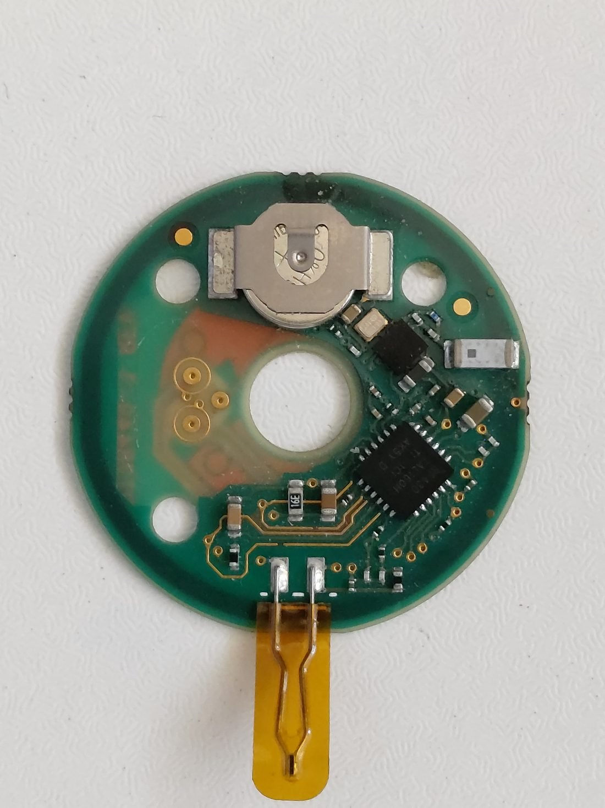
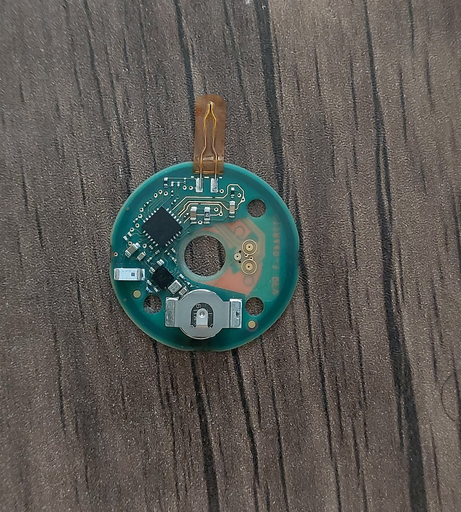
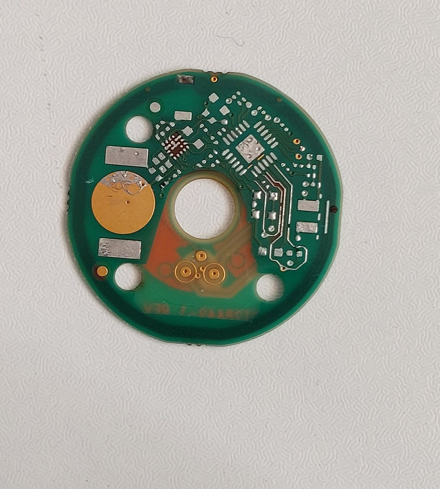
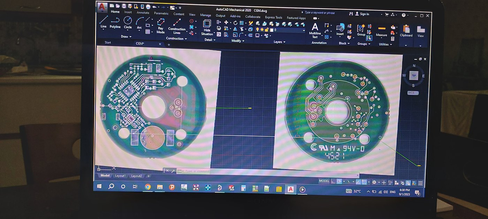

# Reverse-Engineered CGM Board

> A buildable re-design of the electronics of a commercial continuous glucose monitor (CGM),
> made at the Bio-Integrated Microdevices Laboratory (BMDL), Koç University.



## What it is

A CGM is a coin-sized patch that reads glucose all day through a thin electrochemical sensor
under the skin. Before designing our own glucose sensors, I wanted to understand how the
commercial devices do it. I took one apart, traced how its electronics read the sensor and send
the data out, and then redesigned those electronics as my own round circuit board that we can
manufacture and change in the lab.

This board became the starting point for the electronics of the lab's next-generation CGM
devices with electrochemically integrated sensors.

## How it works

- **Sensor read-out.** The glucose electrode produces a very small current that follows the
  glucose level. A sensor-interface chip (TI RF430FRL152H) biases the electrode, digitizes the
  signal and can be read over NFC.
- **Wireless.** A Bluetooth Low Energy module (EM Microelectronic EM9304) is included for
  streaming the readings to a phone.
- **Power.** A coin cell on the board powers the circuit.
- **Shape.** The board is round with a central opening, like the commercial device, and the
  flexible sensor probe attaches at the edge.

| | |
|---|---|
|  |  |



## Repository structure

```
cgm-reverse-engineering/
├── hardware/altium/
│   ├── CGM.PrjPcb    # Altium project (open this)
│   ├── CGM.SchDoc    # schematic
│   ├── CGM.PcbDoc    # board layout
│   ├── CGM.SCHLIB    # schematic symbols
│   └── CGM.PcbLib    # footprints
└── docs/images/
```

## Opening the design

Open `hardware/altium/CGM.PrjPcb` in Altium Designer.

## Status

Designed, fabricated and assembled. Developed at BMDL, Koç University
(PI: Assoc. Prof. Levent Beker).

---

**Author:** Yaşar Aykut Altuntop · MSc student, Biomedical Sciences and Engineering, Koç University  
[LinkedIn](https://linkedin.com/in/aykutaltuntop) · [GitHub](https://github.com/Aykut0)
